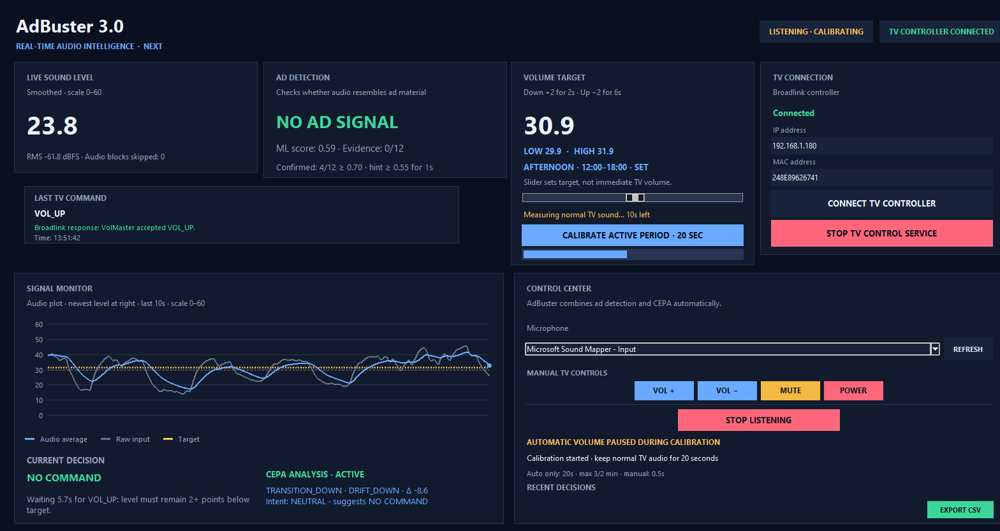
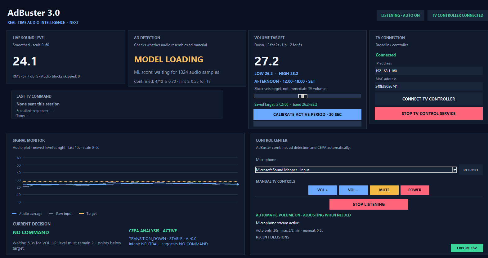
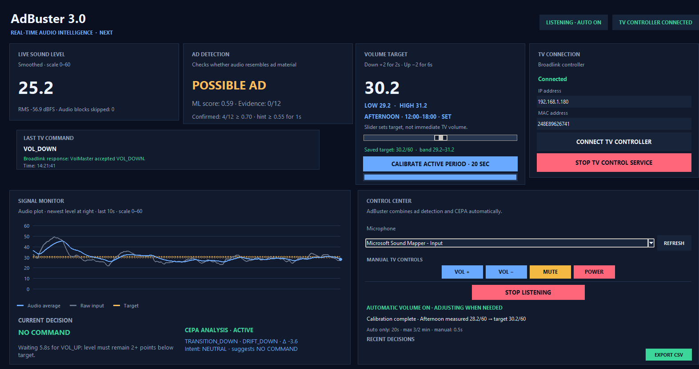
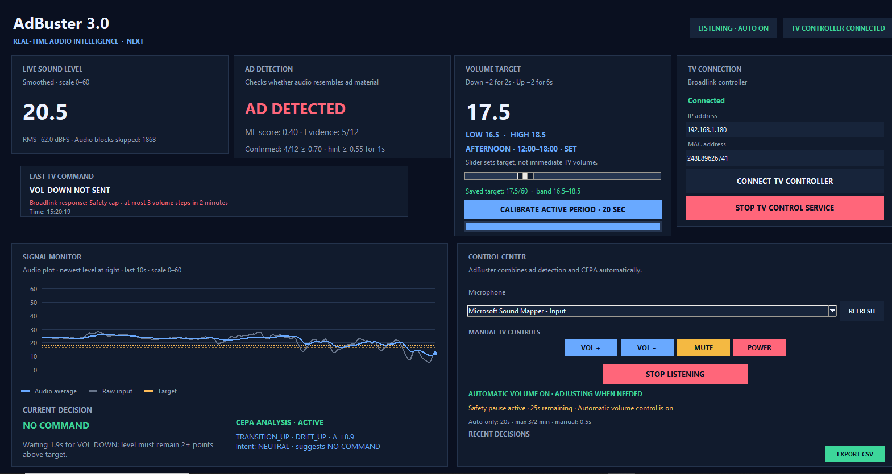
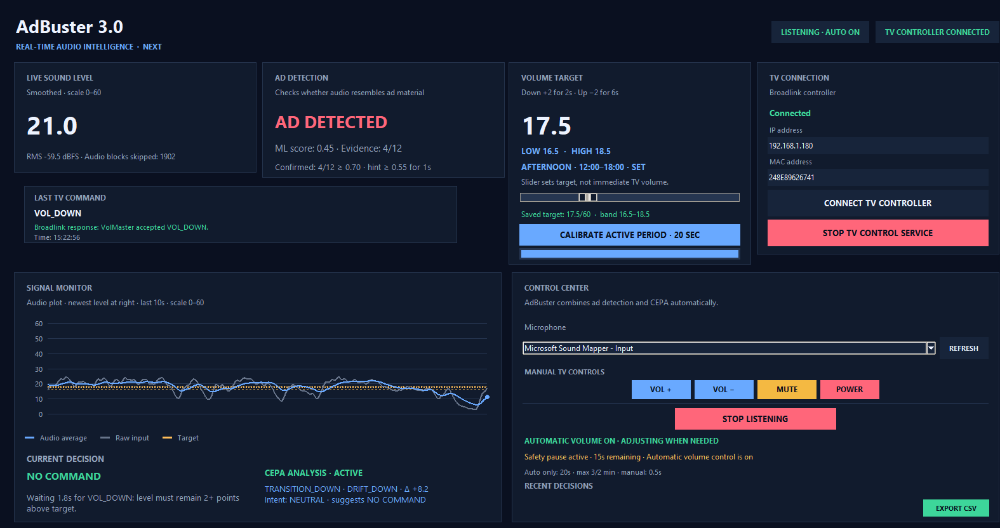
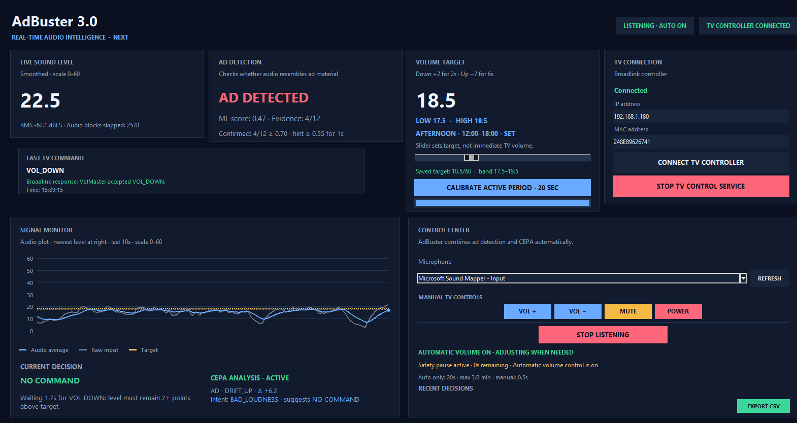

# AdBuster 3.0 — Screenshots Overview

This document illustrates the main operating states of AdBuster 3.0 and demonstrates how Machine Learning, CEPA Logic and automatic TV volume control interact in real-time.

---

## Overview

AdBuster 3.0 continuously monitors television audio, analyzes sound characteristics, detects advertisement patterns and automatically adjusts TV volume while maintaining system stability through multiple safety mechanisms.

The dashboard consists of several core modules:

| Module | Purpose |
|----------|----------|
| Live Sound Level | Real-time audio monitoring and RMS analysis |
| Ad Detection | Machine learning advertisement classification |
| Volume Target | Dynamic listening target management |
| Signal Monitor | Visualization of audio behaviour over time |
| CEPA Analysis | Context-aware interpretation and decision support |
| TV Connection | Broadlink controller status and communication |
| Control Center | Monitoring controls and manual TV commands |

---

# Operational Sequence

The screenshots below represent a typical AdBuster operating cycle.

---

## 1. System Startup & Initialization

At startup the application initializes audio monitoring, connects to the Broadlink controller and activates the CEPA analysis engine.

### Key Observations

- Audio monitoring is active.
- TV controller connection established.
- CEPA analysis layer initialized.
- Automatic volume control enabled.
- Machine learning model is still loading.
- No television commands have been issued.

**State:** System ready, waiting for classification data.

---

## 2. Advertisement Suspicion Detected

The machine learning model begins detecting audio characteristics commonly associated with advertisement material.

### Key Observations

- Status changes to **Possible Ad**.
- ML confidence increases.
- Evidence accumulation begins.
- CEPA remains neutral.
- Monitoring continues without intervention.

**State:** Suspicious audio detected but confirmation threshold not yet reached.

---

## 3. Environment Calibration

The calibration process measures the normal listening environment and calculates contextual volume targets.

### Key Observations

- Calibration procedure active.
- Automatic volume actions temporarily paused.
- Baseline listening level measured.
- CEPA remains active during calibration.
- Future adaptive decisions are based on collected data.

**State:** Learning normal listening behaviour.

---

## 4. Advertisement Confirmed

After sufficient evidence has been collected, the advertisement detection engine confirms advertisement presence.

### Key Observations

- Status changes to **AD DETECTED**.
- Evidence threshold reached.
- Automatic volume reduction executed.
- TV controller accepts command.
- Safety pause becomes active.

**State:** Advertisement confirmed and corrective action taken.

---

## 5. Safety Pause Monitoring

After a volume adjustment, the system enters a temporary protection period to prevent excessive reactions.

### Key Observations

- Advertisement remains active.
- Safety timer still running.
- CEPA evaluates contextual loudness behaviour.
- Additional commands are temporarily delayed.

**State:** Monitoring and validation period.

---

## 6. Safety Cap Protection

If additional adjustments are considered too aggressive, the protection layer blocks further TV commands.

### Key Observations

- Advertisement remains detected.
- Safety cap prevents another volume reduction.
- CEPA continues monitoring.
- Volume control remains stable.
- Oscillation protection activated.

**State:** Protection mechanisms override additional volume actions.

---

# Advertisement Response Workflow

The complete response cycle demonstrated by Screenshots 01–06 is:

1. System startup.
2. Audio monitoring activation.
3. Advertisement suspicion detected.
4. Environment calibration completed.
5. Advertisement confirmed.
6. Volume reduction command executed.
7. Safety pause activated.
8. Additional corrections evaluated by CEPA.
9. Safety limits prevent excessive volume manipulation.
10. Monitoring continues until normal content resumes.

---

# Safety Mechanisms

AdBuster 3.0 includes several safeguards designed to ensure stable operation:

### Evidence Accumulation

Requires repeated observations before confirming advertisement audio.

### Safety Pause

Prevents multiple commands immediately after a volume adjustment.

### Command Limiter

Restricts excessive television volume changes within a short timeframe.

### CEPA Context Analysis

Evaluates behaviour patterns before recommending actions.

### Dynamic Volume Targets

Uses contextual listening ranges instead of fixed thresholds.

---

# Summary

AdBuster 3.0 combines three primary technologies:

- Real-Time Audio Intelligence
- Machine Learning Advertisement Detection
- CEPA Context-Aware Decision Logic

Together these systems detect advertisement-related loudness patterns, determine appropriate corrective actions and safely control television volume while minimizing false positives, command oscillation and unnecessary user intervention.
