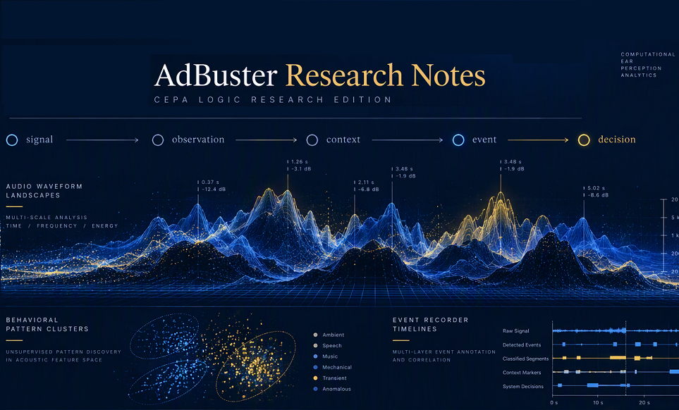

  

# 📝 AdBuster Research Notes

> Technical research notes documenting the development of AdBuster and CEPA Logic.

## 🔁 Articles originally published on LinkedIn.

AdBuster Research Notes documents the ongoing development of AdBuster and CEPA Logic, including research findings, architectural decisions, engineering challenges, experiments, failures, and breakthroughs encountered throughout the project.

🔗 [LinkedIn Newsletter](https://www.linkedin.com/newsletters/adbuster-research-notes-7515027727326916608/)

 

## ✅ Editions

- **2026-11-10** (9) –  [A Month of AdBuster Research Notes: What I Learned](./A%20Month%20of%20AdBuster%20Research%20Notes.md)
- **2026-11-06** (8) –  [AdBuster 3.0 - Inside the Hybrid Prototype](./AdBuster%203.0%20-%20Inside%20the%20Hybrid%20Prototype.md)
- **2026-11-02** (7) –  [Why Context Matters in Intelligent Decision-Making](./Why%20Context%20Matters%20in%20Intelligent%20Decision-Making.md)
- **2026-10-28** (6) –  [Why Stability Matters More Than Accuracy](./Why%20Stability%20Matters%20More%20Than%20Accuracy.md)
- **2026-10-24** (5) –  [Why CEPA Doesn’t Use AGC/DRC: Context Before Action](./Why%20CEPA%20Doesnt%20Use%20AGC-DRC.md)
- **2026-10-21** (4) –  [CEPA Logic Wiki Introduction](./CEPA_Logic_Wiki_Introduction.md)
- **2026-10-19** (3) –  [Why Most Automation Systems Overreact](./Why%20Most%20Automation%20Systems%20Overreact.md)
- **2026-10-15** (2) –  [The Story Behind 987 Commits](./The%20Story%20Behind%20987%20Commits.md)
- **2026-10-11** (1) –  [Why I Created CEPA Logic](./Why%20I%20Created%20CEPA%20Logic.md)

---

## 🎧 Audio Editions — Podcast

Prefer listening to reading? Listen to AdBuster Research Notes on Spotify.

[← Browse Research Notes Audio Library](./podcast/README.md)

---

## 🔼 Upcoming Editions

- **Coming Next** – From Integration to Evidence: Why Repeatable Testing Matters
- The Hidden Engineering Behind a Simple Volume Adjustment
- From Detection Flags to Decisions: Reading the AdBuster PRO Logs

--- 

[← Go to CEPA Logic Wiki](https://github.com/AdBusterOfficial/Adbuster--WinApp/wiki)

[← Go to AdBuster PRO Repository](https://github.com/AdBusterOfficial/Adbuster--WinApp)

---

© 2026 D.P-G. | AdBuster Research Labs, Dublin

 

  

